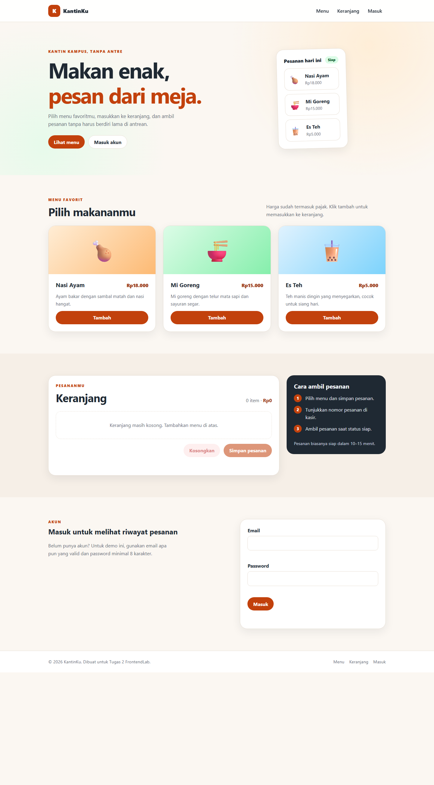

# KantinKu — Tugas 2 FrontendLab

Implementasi halaman pemesanan makanan kampus dengan **HTML, CSS, dan JavaScript murni**. Proyek ini dibuat untuk Tugas 2: Implementasi Komponen Dasar dengan HTML, CSS, dan JavaScript.

## Deskripsi

KantinKu adalah halaman satu layar untuk memesan makanan di kantin kampus. Pengguna dapat melihat menu, menambahkan item ke keranjang, mengubah jumlah, mengosongkan keranjang melalui dialog konfirmasi, menyimpan pesanan dengan status memuat, dan mencoba form masuk dengan validasi.

## Tangkapan layar



## Komponen utama

1. **Header dan menu ponsel** — navigasi utama yang berubah menjadi menu tombol di layar kecil.
2. **Hero** — pengantar singkat dengan ajakan melihat menu.
3. **Kartu produk** — tiga menu dengan harga dan tombol tambah ke keranjang.
4. **Keranjang** — daftar item, jumlah, total Rupiah, tombol ubah jumlah, dan tombol simpan pesanan.
5. **Form masuk** — validasi email dan password dengan pesan error yang jelas.
6. **Dialog konfirmasi** — konfirmasi sebelum mengosongkan keranjang.
7. **Footer** — informasi hak cipta dan tautan navigasi.

## Struktur proyek

```text
tugas-2/
├── index.html                 # Struktur halaman dan konten
├── styles.css                 # Token desain, tata letak, dan responsivitas
├── script.js                  # Interaksi menu, keranjang, dialog, dan validasi
├── favicon.svg                # Ikon situs
├── assets/
│   └── tangkapan-layar.png    # Tangkapan layar halaman
├── SUBMISSION.md              # Teks bantuan untuk form pengumpulan
└── README.md                  # Dokumentasi proyek
```

## Cara menjalankan

Tidak ada dependensi atau proses build.

1. Buka `index.html` langsung di browser, atau
2. Jalankan server lokal dari folder proyek:

   ```bash
   python -m http.server 8000
   ```

   lalu buka `http://localhost:8000`.

## Catatan aksesibilitas

- Struktur memakai elemen semantik: `header`, `nav`, `main`, `section`, `article`, `aside`, `form`, dan `footer`.
- Menu ponsel memakai `aria-expanded` dan `aria-controls`; tombol Escape menutup menu dan mengembalikan fokus.
- Form validasi memakai `aria-invalid`, `aria-describedby`, dan memindahkan fokus ke field pertama yang salah.
- Perubahan keranjang diumumkan lewat `role="status"` dan `aria-live="polite"`.
- Dialog konfirmasi memakai elemen native `<dialog>` dengan `showModal()` dan `close()`.
- Gaya mendukung `prefers-reduced-motion` dan memiliki indikator fokus yang jelas.

## Teknologi

- HTML5
- CSS3: custom properties, Flexbox, Grid, media queries
- JavaScript ES6+: DOM API, `Map`, `Intl`/`toLocaleString`

## Catatan

Halaman ini mengimplementasikan wireframe **KantinKu — halaman pemesanan makanan kampus** yang konsisten dengan komponen pada lab-lab sebelumnya. Jika wireframe Tugas 1 berbeda, konten dan komponen dapat disesuaikan tanpa mengubah struktur dasar proyek.
